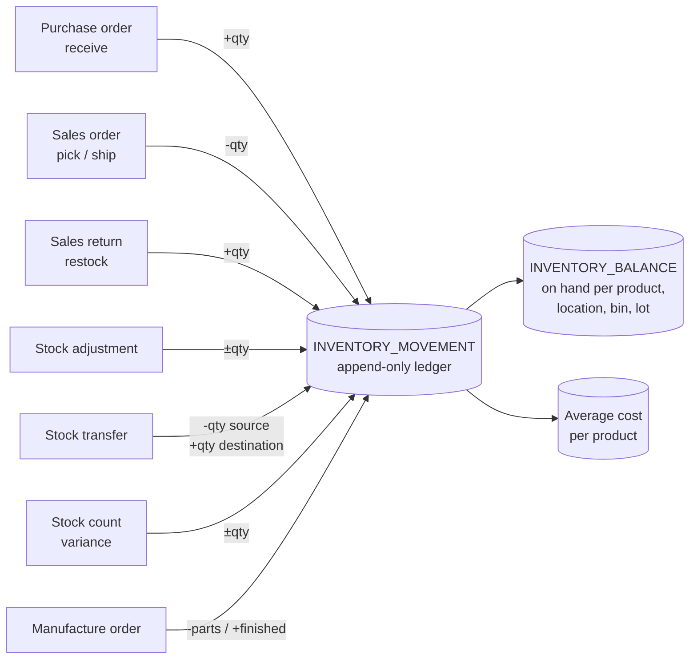

# Database Design — Simple Relational Diagram

Companion to `01-business-prd.md`. This is the **simplified core model** (22 tables):
only the tables and key columns needed to understand how the system fits together.
Every table also has a `company_id` (multi-tenant), which is left off the diagram to keep it readable.

**Legend:** `PK` = primary key · `FK` = foreign key · `||--o{` = one-to-many · `|o--o{` = optional one-to-many

## 1. Full picture

```mermaid
erDiagram
    %% ---------- Catalog ----------
    CATEGORY ||--o{ CATEGORY : "parent of"
    CATEGORY ||--o{ PRODUCT : groups
    PRODUCT ||--o{ PRODUCT_BARCODE : has
    PRODUCT ||--o{ PRODUCT_PRICE : "priced in"
    PRICING_SCHEME ||--o{ PRODUCT_PRICE : contains
    PRODUCT ||--o{ BOM_COMPONENT : "is assembly"
    PRODUCT ||--o{ VENDOR_ITEM : "bought as"
    VENDOR ||--o{ VENDOR_ITEM : sells
    PRODUCT ||--o{ REORDER_SETTING : "reorder rule"
    LOCATION ||--o{ REORDER_SETTING : "applies at"

    %% ---------- Inventory ----------
    LOCATION ||--o{ SUBLOCATION : contains
    PRODUCT ||--o{ LOT : "tracked by"
    PRODUCT ||--o{ INVENTORY_BALANCE : "stocked as"
    LOCATION ||--o{ INVENTORY_BALANCE : holds
    SUBLOCATION |o--o{ INVENTORY_BALANCE : "bin"
    LOT |o--o{ INVENTORY_BALANCE : "batch"
    PRODUCT ||--o{ INVENTORY_MOVEMENT : "history"
    LOCATION ||--o{ INVENTORY_MOVEMENT : "at"

    %% ---------- Sales ----------
    CUSTOMER ||--o{ SALES_ORDER : places
    PRICING_SCHEME |o--o{ CUSTOMER : "default prices"
    SALES_ORDER ||--o{ SALES_ORDER_LINE : contains
    PRODUCT ||--o{ SALES_ORDER_LINE : "sold as"
    SALES_ORDER ||--o{ SHIPMENT : "shipped in"

    %% ---------- Purchasing ----------
    VENDOR ||--o{ PURCHASE_ORDER : receives
    PURCHASE_ORDER ||--o{ PURCHASE_ORDER_LINE : contains
    PRODUCT ||--o{ PURCHASE_ORDER_LINE : "bought as"

    %% ---------- Stock operations ----------
    LOCATION ||--o{ STOCK_ADJUSTMENT : "adjusted at"
    LOCATION ||--o{ STOCK_TRANSFER : "from / to"
    LOCATION ||--o{ STOCK_COUNT : "counted at"
    LOCATION |o--o{ MANUFACTURE_ORDER : "built at"

    %% ---------- Money ----------
    PAYMENT ||--o{ PAYMENT_ALLOCATION : "split across"
    SALES_ORDER |o--o{ PAYMENT_ALLOCATION : "paid by"
    PURCHASE_ORDER |o--o{ PAYMENT_ALLOCATION : "paid by"

    %% ---------- People ----------
    ROLE ||--o{ TEAM_MEMBER : grants
    TEAM_MEMBER |o--o{ SALES_ORDER : "sales rep"

    CATEGORY {
        uuid category_id PK
        uuid parent_id FK
        text name
    }
    PRODUCT {
        uuid product_id PK
        uuid category_id FK
        text name "unique"
        text sku "unique, optional"
        enum item_type "stocked | non_stocked | service"
        text standard_uom
        bool track_lots
        bool track_serials
        bool is_active
    }
    PRODUCT_BARCODE {
        text barcode PK
        uuid product_id FK
    }
    PRICING_SCHEME {
        uuid pricing_scheme_id PK
        text name
        char currency_code
        bool is_tax_inclusive
    }
    PRODUCT_PRICE {
        uuid product_id PK,FK
        uuid pricing_scheme_id PK,FK
        enum price_type "fixed | markup"
        decimal unit_price
        decimal markup_pct
    }
    BOM_COMPONENT {
        uuid product_id PK,FK "assembly"
        uuid component_id PK,FK "part (also a PRODUCT)"
        decimal quantity
    }
    VENDOR_ITEM {
        uuid vendor_id PK,FK
        uuid product_id PK,FK
        text vendor_item_code
        decimal unit_cost
        int lead_time_days
    }
    REORDER_SETTING {
        uuid product_id PK,FK
        uuid location_id PK,FK
        decimal reorder_point
        decimal reorder_qty
        enum method "PO | manufacture | transfer"
    }
    LOCATION {
        uuid location_id PK
        text name
        bool is_default
    }
    SUBLOCATION {
        uuid sublocation_id PK
        uuid location_id FK
        text code "bin e.g. A-03-2"
    }
    LOT {
        uuid lot_id PK
        uuid product_id FK
        text lot_number
        date expires_on
    }
    INVENTORY_BALANCE {
        uuid product_id FK
        uuid location_id FK
        uuid sublocation_id FK
        uuid lot_id FK
        text serial
        decimal on_hand
    }
    INVENTORY_MOVEMENT {
        bigint movement_id PK
        uuid product_id FK
        uuid location_id FK
        decimal qty_delta "+ in / - out"
        decimal unit_cost
        text source_type "sales_order, purchase_order..."
        uuid source_id "the document"
        timestamp effective_at
    }
    CUSTOMER {
        uuid customer_id PK
        uuid pricing_scheme_id FK
        text name
        text email
        decimal credit_limit
    }
    SALES_ORDER {
        uuid sales_order_id PK
        uuid customer_id FK
        uuid sales_rep_id FK
        text order_number "unique"
        bool is_quote
        enum inventory_status "unfulfilled | started | fulfilled"
        enum payment_status "uninvoiced | invoiced | partial | paid"
        decimal total
        decimal amount_paid
    }
    SALES_ORDER_LINE {
        uuid line_id PK
        uuid sales_order_id FK
        uuid product_id FK
        decimal quantity "negative = return"
        decimal unit_price
        decimal discount
    }
    SHIPMENT {
        uuid shipment_id PK
        uuid sales_order_id FK
        text carrier
        text tracking_number
        timestamp shipped_at
    }
    VENDOR {
        uuid vendor_id PK
        text name
        char currency_code
        int lead_time_days
    }
    PURCHASE_ORDER {
        uuid purchase_order_id PK
        uuid vendor_id FK
        text order_number "unique"
        enum inventory_status "unapproved | unfulfilled | started | fulfilled"
        enum payment_status "unpaid | partial | paid"
        decimal freight
        decimal total
    }
    PURCHASE_ORDER_LINE {
        uuid line_id PK
        uuid purchase_order_id FK
        uuid product_id FK
        decimal quantity "negative = return"
        decimal unit_price
    }
    STOCK_ADJUSTMENT {
        uuid stock_adjustment_id PK
        uuid location_id FK
        text reason
        timestamp adjusted_at
    }
    STOCK_TRANSFER {
        uuid stock_transfer_id PK
        uuid from_location_id FK
        uuid to_location_id FK
        enum status "open | in_transit | completed"
    }
    STOCK_COUNT {
        uuid stock_count_id PK
        uuid location_id FK
        enum status "open | in_progress | in_review | completed"
    }
    MANUFACTURE_ORDER {
        uuid manufacture_order_id PK
        uuid location_id FK
        enum status "open | in_progress | completed"
        date due_date
    }
    PAYMENT {
        uuid payment_id PK
        enum party "customer | vendor"
        decimal amount
        date paid_on
        text method
    }
    PAYMENT_ALLOCATION {
        uuid payment_id FK
        uuid sales_order_id FK "one of these two"
        uuid purchase_order_id FK
        decimal amount
    }
    ROLE {
        uuid role_id PK
        text name
        text_array permissions
    }
    TEAM_MEMBER {
        uuid team_member_id PK
        uuid role_id FK
        text email
        decimal po_approval_limit
    }
```

> Stock adjustments, transfers, counts and manufacture orders each have **line tables**
> (product + qty) like sales/purchase orders do. They're left out above to keep it simple.

## 2. How stock moves (the one rule to remember)

Nothing edits `on_hand` directly. Every document writes a row to **INVENTORY_MOVEMENT**,
and **INVENTORY_BALANCE** is updated in the same transaction.

## 3. Table groups at a glance

| Group | Tables | Purpose |
|---|---|---|
| **Catalog** | Category, Product, Product Barcode, Pricing Scheme, Product Price, BOM Component, Vendor Item, Reorder Setting | What you sell/buy, how it's priced, what it's made of, when to reorder |
| **Inventory** | Location, Sublocation, Lot, Inventory Balance, Inventory Movement | Where stock is, how much, and its full history |
| **Sales** | Customer, Sales Order, Sales Order Line, Shipment | Quote → order → ship → invoice |
| **Purchasing** | Vendor, Purchase Order, Purchase Order Line | RFQ → PO → receive |
| **Stock ops** | Stock Adjustment, Stock Transfer, Stock Count, Manufacture Order | Changes to stock that aren't buying or selling |
| **Money** | Payment, Payment Allocation | One payment can settle several orders |
| **People** | Role, Team Member | Who can do what |

## 4. Key design decisions

1. **Ledger + balance.** Movements are never edited. This gives you an audit trail,
   "stock on any past date" reports, and lot/serial traceability for free.
2. **Quantities are derived, not stored.** *Available* = on hand − reserved (open order lines).
   *On order* = open PO lines − received. They're calculated, so they can't drift.
3. **Two statuses per order.** Inventory status (shipped?) and payment status (paid?) move
   independently, which matches how SMBs actually work.
4. **Returns are negative lines** on the original order, not separate documents.
5. **BOMs are self-referencing.** A component is just another product, so multi-level assemblies work automatically.
6. **Multi-tenant.** Every table has `company_id`, enforced by database row-level security.
7. **Soft delete.** Products, customers, vendors and locations are deactivated (`is_active = false`), never deleted once used.
