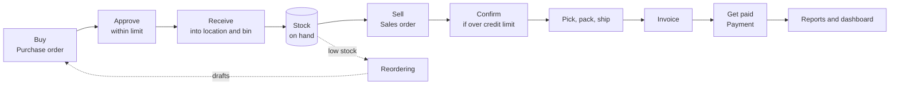

# 00. What this product is, and how the business flows

Study notes for the project presentation. Plain English first, with pointers to the real code and specs when you want proof.

## In one paragraph

This is a cloud **inventory and order management** web app for small businesses, modelled on Zoho Inventory. A shop, wholesaler or small distributor uses it to buy stock from vendors, receive it into warehouses, keep an exact count of what is where, sell to customers, pick, pack and ship orders, record payments, and see reports. It is a React + Vite front end. All the backend services (sign-in, roles, data storage, files, email) come from **SELISE Blocks**, so there is no custom server.

## The main modules

The sidebar groups them like this (from `src/app/layout/AppShell.tsx`):

| Sidebar section | Menu items | What it is for |
|---|---|---|
| (top) | **Dashboard** | Home page: tiles each person picks (Sales today, Low stock count, Open orders), shortcuts, low-stock alerts, and for Admins a starter-data card |
| **Sales** | Sales orders, Customers, Price lists, Payments | Quote → order → pick/pack/ship → invoice → get paid |
| **Purchasing** | Purchase orders, Vendors | Quote request → PO → approve → receive → pay vendor |
| **Inventory** | Products, Categories, Stock, Adjustments, Transfers, Counts, Lots and serials, Reordering, Locations, Fixed assets, Close month | The catalog, stock levels and every way stock changes, plus fixed assets that lose value |
| **Reports** | Reports | 21 ready-made reports (sales, purchasing, inventory, depreciation), exported to CSV or printed to PDF |
| **Settings** | Company, Currencies, Numbering, Depreciation, Lists and taxes, Team, Security, Appearance | Company setup, team and roles, two-step login, theme |

Each person only sees the menu items their role may open (`src/features/team/screen-access.ts`). See the role docs for who sees what.

## The end-to-end business flow

Step by step, with a real example: *"Dhaka Gadgets" sells phone chargers.*

1. **Buy.** The purchaser makes a purchase order (PO) to the vendor for 100 chargers. The PO can start as a quote and be converted.
2. **Approve.** A PO stays *Unapproved* until someone whose personal approval limit covers the total approves it. If the person who saves it has a high enough limit, it is approved on save.
3. **Receive.** When the boxes arrive, the warehouse or purchaser clicks **Receive**, picks the location and bin, and enters lots or serials if the product tracks them. Receiving can be partial (60 today, 40 next week). Freight and other costs on the PO are spread over the received lines (*landed cost*), which updates the product's *average cost*.
4. **Stock.** Every change writes one row to the stock ledger (`InventoryMovement`) and updates the running total (`InventoryBalance`). Nobody types "on hand" directly.
5. **Sell.** A sales rep makes a quote, converts it to a sales order. Prices come from the customer's price list.
6. **Confirm.** If this order pushes the customer over their credit limit, the order is held (*Unconfirmed*) until an Admin or Manager clicks **Confirm order**.
7. **Pick, pack, ship.** The warehouse uses the **Fulfillment queue** tab, opens an order, clicks **Start picking** (locks the order for 30 minutes so two people don't pick the same one), then **Pick**, **Pack** and **Ship** (or the **Quick actions**: Pick all, Pack all, Ship all, Fulfill). Anything not shipped stays open as a *back order*. Picking takes stock out of on hand and fixes the cost of goods.
8. **Invoice and get paid.** **Invoice today** marks the order invoiced. **Record payment** (or **Pay in full**) records money in; one payment can be split across several orders. Vendor bills are paid the same way with **Pay vendor** on a PO.
9. **Reports.** Sales profit, inventory value, stock as of a past date, back orders, lot expiry and more. Cost columns are hidden from people without cost access.

Side loops you should know:

- **Reordering**: when *anticipated* stock falls below a product's reorder point, it shows on the Reordering list, and one click drafts POs (grouped by vendor) or transfers (grouped by source location).
- **Adjustments, transfers, counts**: the three ways stock changes without buying or selling (breakage, moving stock between stores, a stock take).
- **Returns**: a negative line on the original sales order, then **Restock returns**. Returns to a vendor use **Return to vendor** on the PO.
- **Fixed assets**: things the company owns and uses (a delivery van, a laptop) rather than sells. They lose value every month by the written-down-value method, and an Admin closes each month (spec 0028).

## Two statuses on every order

Each sales order and PO has two statuses that move independently, because small businesses often ship before they get paid, or get paid before they ship.

| | Sales order | Purchase order |
|---|---|---|
| **Inventory status** | Quote, Unconfirmed, Unfulfilled, Started, Fulfilled | Quote, Unapproved, Unfulfilled, Started, Fulfilled |
| **Payment status** | Quote, Unconfirmed, Uninvoiced, Invoiced, Partial, Paid, Owing | Quote, Unapproved, Unpaid, Partial, Paid, Owing |

The app works these out from the lines, shipments and payments. Nobody sets them by hand (spec 0011 AC-4, spec 0012 AC-6).

## What "SELISE Blocks" gives us

| Need | Blocks piece |
|---|---|
| Sign-in, sessions, two-step login (MFA), invites | Blocks IAM (hosted login) |
| Seven roles | Blocks IAM roles |
| Company separation | Blocks organizations: every record carries `OrganizationId` |
| Data tables | Blocks Data Gateway: 60 schemas in `blocks/data/schemas/` |
| Low-stock emails | Blocks mail |
| File storage | Blocks storage |

Important honesty point: Blocks has no multi-record transactions. The app writes stock safely with a **compare and set** on each balance row (spec 0026): it only updates the row if its `version` hasn't changed, and retries otherwise. A live test fired 12 takes at 10 units of stock at once: 10 posted, 2 were refused, and on hand ended at exactly 0.

## Glossary

| Term | Plain meaning | Where in the app |
|---|---|---|
| **On hand** | Units physically in the building right now. Picked units have already left on hand. | Stock screen; `InventoryBalance.onHand` |
| **Picked** | Taken off the shelf for an order but not shipped yet. | Stock screen |
| **Committed / reserved** | Promised to open sales orders (not yet picked) or to transfers not yet sent. The app calls it *reserved*; Zoho calls it *committed*. | Stock screen |
| **Available** | What you can still promise: **on hand − reserved**. | Stock screen |
| **On order** | Ordered from vendors but not received, plus transfers coming in. | Stock screen |
| **In transit** | Sent on a transfer and not received at the other end yet. | Stock screen, Transfers |
| **Anticipated** | **on hand − reserved + on order**. This drives reordering. | Reordering |
| **Location** | A warehouse, store, truck or site. | Locations |
| **Bin (sublocation)** | A shelf or spot inside a location. | Locations |
| **Lot** | A batch of the same product with a lot number and dates (made on, expires on, sell by). The app suggests the lot that expires first and never auto-picks an expired lot. | Lots and serials |
| **Serial** | One unique unit (a phone with its IMEI). Its stock is always 0 or 1 at a place. | Lots and serials |
| **Traceability** | Forward: which customers got lot X. Backward: which PO brought serial Y in. | Lots and serials |
| **Average cost** | Moving average cost per unit. On each receipt: new average = (old qty × old average + received qty × landed unit cost) ÷ (old qty + received qty). | Product (cost viewers only) |
| **Landed cost** | The vendor price plus a share of freight, duty and other PO costs, spread by value (default), weight or volume. | PO detail: "Landed unit cost" |
| **Cost of goods (COGS)** | The average cost fixed onto each unit when it is picked. Revenue − COGS = profit. | Order detail: Profit; Sales profit report |
| **Reorder point** | When anticipated stock drops below this number, reorder. Suggested value: daily sales rate (last 90 days) × vendor lead time + safety stock. | Reordering |
| **Reorder quantity** | How many to order when you do. | Reordering |
| **Safety stock** | A cushion added to the reorder point. | Reordering |
| **Back order** | The part of an order you could not ship yet; it stays open and ships later. | Back orders report |
| **Price list (pricing scheme)** | A set of prices for a group of customers (e.g. Wholesale), in one currency, with optional volume price breaks. | Price lists |
| **Credit limit** | The most a customer may owe. Going over holds the order for confirmation. | Customers |
| **Approval limit** | The largest PO total (in home currency) a person may approve. | Team, per-person settings |
| **Adjustment** | A stock change with a reason (damaged, lost, found, opening stock). | Adjustments |
| **Transfer** | Moving stock between locations: Open → In transit → Completed. | Transfers |
| **Count (stock take)** | Counting a location, split into sheets per person, reviewed, then differences posted as adjustments. | Counts |
| **Ledger / movement** | The never-edited history row written for every quantity change. | Movement history report |
| **Fixed asset** | Something the company owns and uses, not sells. | Fixed assets |
| **Depreciation (WDV)** | Loss of value over time. Written-down value: each year's charge is a percentage of the value left, not of the original cost. | Fixed assets, Close month |
| **Close month** | Locking a month's depreciation. Entries never change afterwards; only an Admin can reopen. | Close month |
| **Home currency** | The company's main currency; reports and approval limits use it. | Company, Currencies |
| **Organization** | One company inside Blocks. Users never see another company's records. | Team |

## Where to read more

- Product requirements: `docs/01-business-prd.md`
- Database design (original relational view): `docs/02-database-design.md`
- What is built and what is planned: `docs/scope/scope.md`
- Feature specs: `docs/specs/0001` to `0029`
