# Schema relationships

All 60 data schemas in `blocks/data/schemas/`, grouped by business area, with diagrams. Field names are copied from the JSON files. Unique keys come from `blocks/data/indexes.json`.

## Read this first

- **Two kinds of schema.** `schemaType 1` is a real collection (a table you can query). `schemaType 2` is a **value type**: it has no table of its own and is stored *inside* its parent record. For example, a `SalesOrder` holds its `SalesLine` list. One order and all its lines save in one write, which matters because Blocks has no multi-record transactions. There are 44 collections and 16 value types.
- **System fields** are added by Blocks to every collection and are not in the JSON: `ItemId` (the primary key), `OrganizationId` (which company), `CreatedBy`, `CreatedDate`, `LastUpdatedBy`, `LastUpdatedDate`. Every `...Id` field of type `ID` points at another record's `ItemId`.
- **No foreign keys on the server.** Blocks does not enforce links. The app keeps them correct. Records that are in use are deactivated (`isActive = false`), not deleted.
- **Original design.** `docs/02-database-design.md` is the first relational design (with tables like `SALES_ORDER_LINE`). On Blocks, line tables became embedded value types, and `ROLE` / `TEAM_MEMBER` became Blocks IAM roles and users plus `TeamMemberProfile`.

In the diagrams: `PK` = primary key, `FK` = points at another record, `UK` = part of a unique key. Value types are marked `(embedded)` in the purpose tables.

## Overview: how the areas link

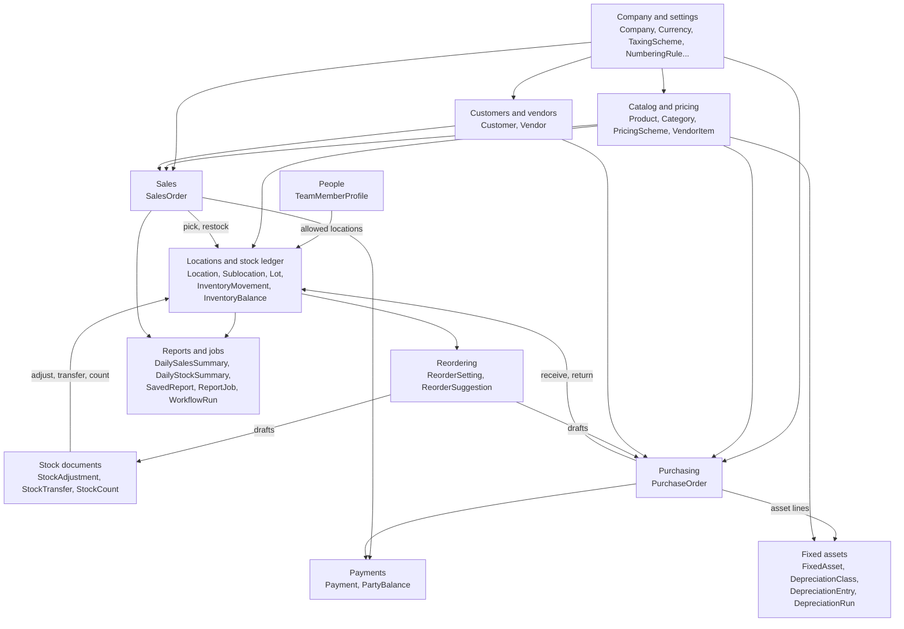

The heart is the **stock ledger**. Sales, purchasing and stock documents never change quantities directly; they all post movements to it.

---

## 1. Company and settings

| Schema | Purpose |
|---|---|
| `Company` | The company profile, one per organization: name, home currency, time zone, country, plus the depreciation control state (`depreciationStatus`, `depreciationLatestClosed`...). |
| `Currency` | A currency the company trades in (`code` unique, symbol, decimals). |
| `ExchangeRate` | A rate for a currency from an effective date. |
| `NumberingRule` | Running document numbers per document type (`prefix`, `padding`, `nextNumber`). |
| `TaxingScheme` | A set of up to two taxes (rates, on shipping, compounding, tax inclusive). |
| `TaxCode` | A per-product tax rate inside a taxing scheme. |
| `PaymentTerm` | Payment terms, such as Net 30 (`daysDue`). |
| `PaymentMethod` | Cash, bank transfer, card... |
| `Carrier` | Shipping carriers. |
| `AdjustmentReason` | Reasons for stock adjustments (system ones such as "Opening stock" have `isSystem`). |
| `Address` | (embedded) A postal address inside customers, vendors and orders. |
| `Contact` | (embedded) A contact person inside customers, vendors and orders. |

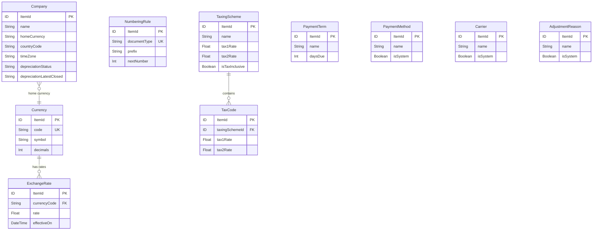

`Company.homeCurrency` and `ExchangeRate.currencyCode` hold the currency code (a String), not an `ItemId`.

## 2. People and access

| Schema | Purpose |
|---|---|
| `TeamMemberProfile` | Per-person settings Blocks users don't hold: PO approval limit, allowed locations, own customers only, stockroom user flag, dashboard tiles. One per user (`userId` unique). |

Users, roles and organizations themselves live in **Blocks IAM**, not in data schemas.

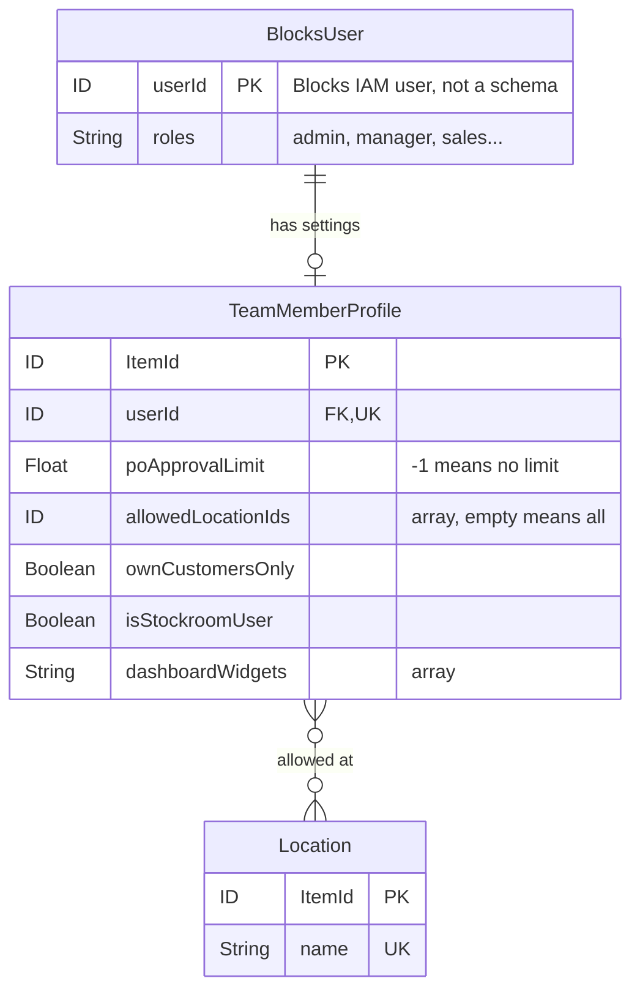

## 3. Catalog and pricing

| Schema | Purpose |
|---|---|
| `Category` | A product category; `parentId` makes it a tree. |
| `Product` | A product or service: SKU, units and ratios, size and weight, tracking flags (lots, serials, expiry), `averageCost` guarded by `costVersion`, last vendor, depreciation class for asset products. |
| `ProductBarcode` | A barcode for a product, unique across the company. |
| `VendorItem` | What one vendor calls and charges for one product: code, unit cost, lead time, preference. |
| `PricingScheme` | A price list (Retail, Wholesale) in one currency. |
| `ProductPrice` | A product's price in one price list (fixed price or markup). |
| `PriceBreak` | A volume price: from `minQty` units, this unit price. |

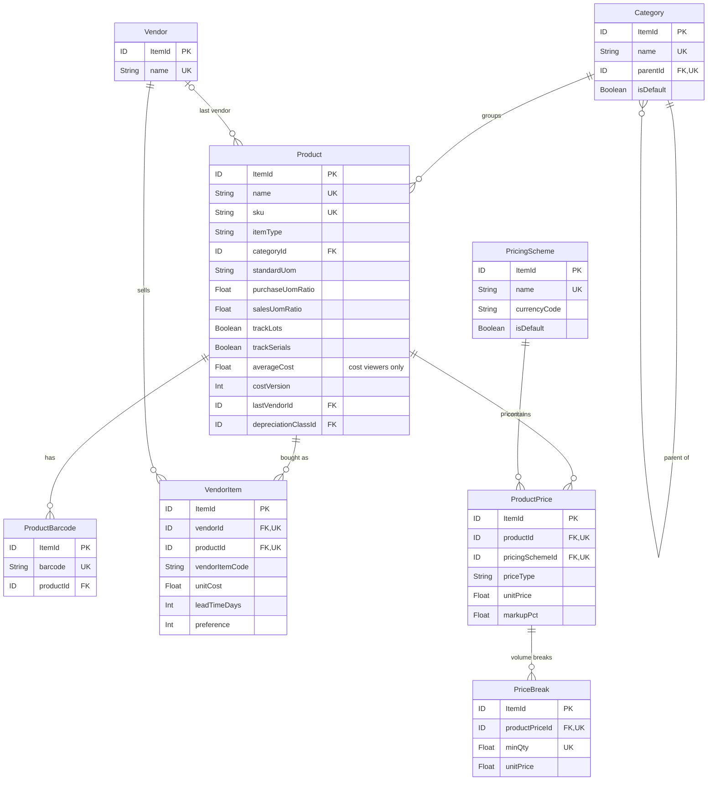

## 4. Customers and vendors

| Schema | Purpose |
|---|---|
| `Customer` | A customer with defaults copied onto new orders: price list, taxing scheme, terms, currency, discount, sales rep, credit limit, addresses, contacts. |
| `Vendor` | A vendor with currency, terms, lead time, address, contacts. |

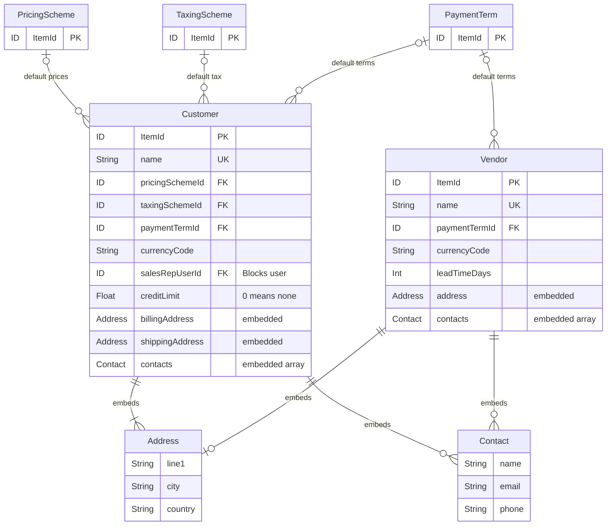

## 5. Locations and the stock ledger

| Schema | Purpose |
|---|---|
| `Location` | A warehouse, store, truck or site (`kind`). |
| `Sublocation` | A bin inside a location (`code` unique per location). |
| `Lot` | A batch of one product with made on, expires on, sell by dates (`lotNumber` unique per product). |
| `InventoryMovement` | **The ledger.** One row per quantity change: product, location, bin, lot, serial, signed `qtyDelta`, `unitCost`, which document caused it (`sourceType`, `sourceId`), `status` (pending, posted, failed, reversed), unique `postingKey`. Never edited after posting. |
| `InventoryBalance` | Running on hand per (product, location, bin, lot, serial), with `picked`, a `version` for compare and set, and `appliedKeys` (last 50 posting keys) for repair. |

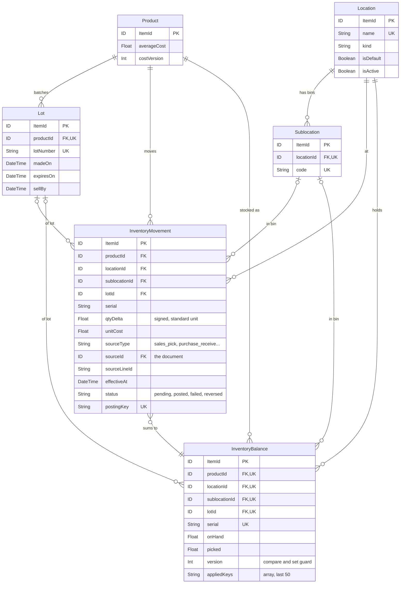

`sourceType` values in code (`src/features/stock/posting.ts`): `adjustment`, `adjustment_reversal`, `transfer_send`, `transfer_receive`, `transfer_reversal`, `purchase_receive`, `po_unstock`, `purchase_reversal`, `sales_pick`, `sales_restock`, `sales_reversal`, `mo_pick`, `mo_put`, `rollback`.

## 6. Stock documents (adjust, transfer, count)

| Schema | Purpose |
|---|---|
| `StockAdjustment` | A stock change with a reason at one location; `costStatus` guards the one-time cost update for "Opening stock" (spec 0029). |
| `AdjustmentLine` | (embedded) One adjusted line: product, bin, lot or serial, signed `qtyDelta`, `unitCost`. |
| `StockTransfer` | Moving stock from one location to another; `status` Open → In transit → Completed. |
| `TransferLine` | (embedded) One transferred line, with from and to bins. |
| `StockCount` | A stock take at one location, split into sheets; links to the `adjustmentId` it posted. |
| `CountSheet` | (embedded) One person's part of a count (`assigneeId`, `status`). |
| `CountLine` | (embedded) Expected vs counted quantity for one product, bin, lot or serial. |

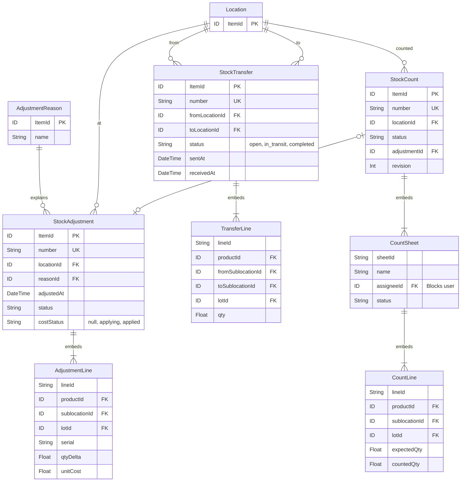

## 7. Sales

| Schema | Purpose |
|---|---|
| `SalesOrder` | A sales quote or order with everything inside it: snapshot of customer details, lines, packages, shipments, stock steps, history, derived `inventoryStatus` and `paymentStatus`, `cogs`, credit hold (`needsConfirmation`, `confirmedBy`), picking lock. |
| `SalesLine` | (embedded) One order line, with progress counters `pickedQty`, `packedQty`, `shippedQty`, `restockedQty`. A negative `qty` is a return (`returnAction`). |
| `SalesPackage` | (embedded) A box packed for the order. |
| `PackageLine` | (embedded) Which line and how many units are in a package. |
| `SalesShipment` | (embedded) A shipment: carrier, tracking number, the packages in it. |
| `StockStep` | (embedded, shared with POs) One stock action on an order (pick, restock, receive, unstock) with its own status, so a half-finished step can be settled from the ledger. |
| `StockStepLine` | (embedded) A line of a stock step: quantity, bin, lot, serial, unit cost. |
| `OrderEvent` | (embedded, shared with POs) One history entry: when, who, what. |

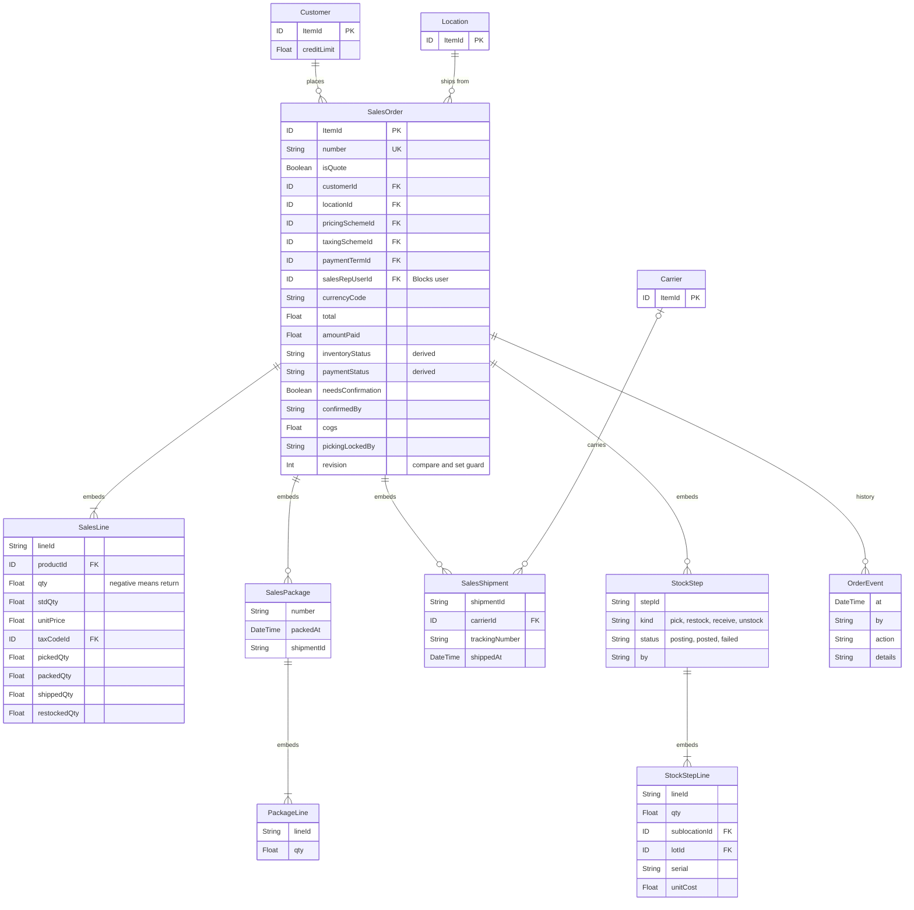

`PackageLine.lineId` and `StockStepLine.lineId` point at a `SalesLine.lineId` in the same order. `SalesShipment.packageNumbers` lists `SalesPackage.number` values.

## 8. Purchasing

| Schema | Purpose |
|---|---|
| `PurchaseOrder` | A purchase quote or PO with everything inside: vendor snapshot, receive location, currency and rate, freight, non-vendor costs, landed cost method (`allocationMethod`), approval (`approvedBy`, `approvedAt`), lines, stock steps, history, derived statuses. Can be a dropship for a sales order. |
| `PurchaseLine` | (embedded) One PO line, with `receivedQty`. A negative `qty` is a return to vendor. |
| `ExtraCost` | (embedded) A non-vendor cost such as duty or insurance (percent or fixed), spread into landed cost. |

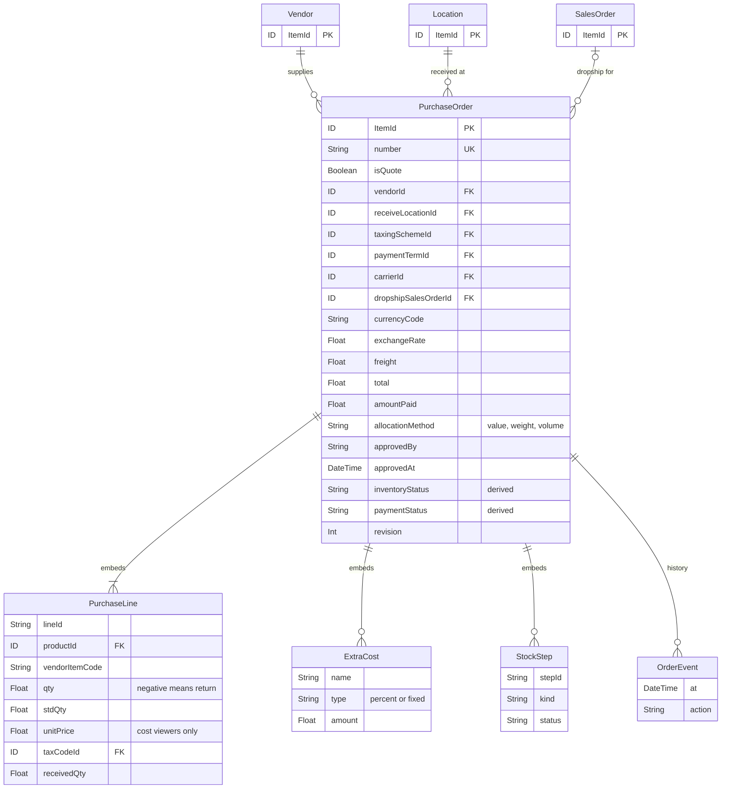

## 9. Payments and balances

| Schema | Purpose |
|---|---|
| `Payment` | A customer or vendor payment (or refund, store credit, batch), with its split across orders inside. `party` says customer or vendor; `partyId` is that record. |
| `PaymentAllocation` | (embedded) How much of the payment goes to one order (`orderType` sales or purchase, `orderId`). |
| `PartyBalance` | Open balance and store credit per customer or vendor and currency, a precomputed total (unique on party, partyId, currencyCode). |

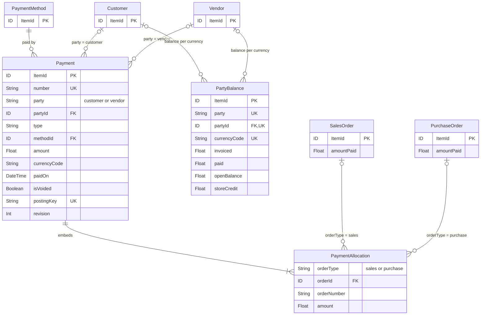

## 10. Reordering

| Schema | Purpose |
|---|---|
| `ReorderSetting` | Reorder point, quantity, safety stock and method (PO, transfer, manufacture) per product and location, with the preferred vendor or source location and alert state. |
| `ReorderSuggestion` | The rebuilt list of products below their reorder point, with the quantities used (on hand, reserved, on order, anticipated) and a suggested quantity. |

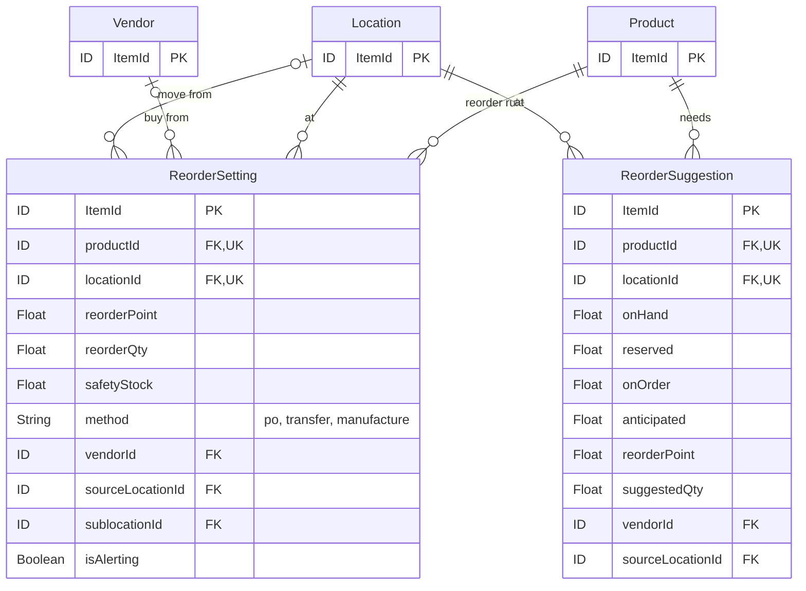

## 11. Reports and background jobs

| Schema | Purpose |
|---|---|
| `DailySalesSummary` | Sales per day, product, location, customer and rep in home currency (qty, revenue, cogs, tax). Pre-added because Blocks cannot sum on the server. |
| `DailyStockSummary` | Stock on hand and value per day, product and location. |
| `SavedReport` | A person's saved report filters and columns, optionally shared. |
| `ReportJob` | **Dormant.** Was used by "Run in the background" (removed 2026-10-29). Kept, not deleted (see `docs/designs/instant-report-export.md`). |
| `WorkflowRun` | One row per scheduled-job run; the unique `runKey` makes the daily reorder check run once a day. |

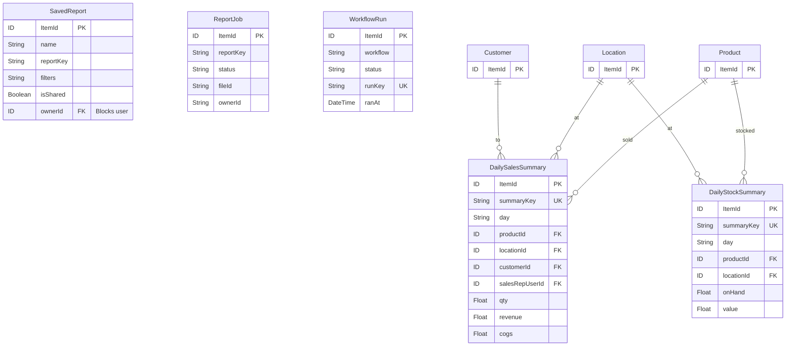

## 12. Fixed assets and depreciation

| Schema | Purpose |
|---|---|
| `DepreciationClass` | A depreciation class and yearly rate (WDV method), per organization, maybe copied from a country preset. |
| `FixedAsset` | One owned unit that loses value: product, class, location, the PO it came from, serial, in-service date, cost, opening WDV, status, disposal. |
| `DepreciationEntry` | One month's depreciation for one asset, never edited (unique on asset and period). |
| `DepreciationRun` | The audit log of month closes and reopens. |

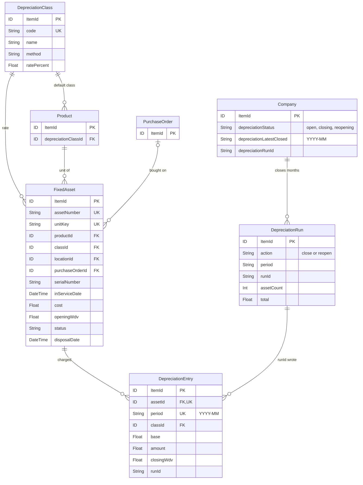

## 13. Temporary

| Schema | Purpose |
|---|---|
| `CostProbe` | A scratch schema (`name`, `cost`) used to test whether Blocks can hide a column for some roles (spec 0003 AC-5). To be deleted after that decision (build step 5d). |

---

## How stock quantities are derived (specs 0007 and 0026)

### The one rule

**Nobody edits on hand.** Every stock change (receive, pick, restock, adjust, transfer, count) goes through one posting engine (`src/features/stock/posting.ts`), which writes a movement and updates the balance. So:

- `InventoryBalance.onHand` = the sum of its posted `InventoryMovement.qtyDelta` rows (spec 0007 AC-2).
- Stock on any past date can be rebuilt by summing movements up to that date (the "Stock as of a date" report).
- Cancelling a document writes *reversing* movements; history is never rewritten.

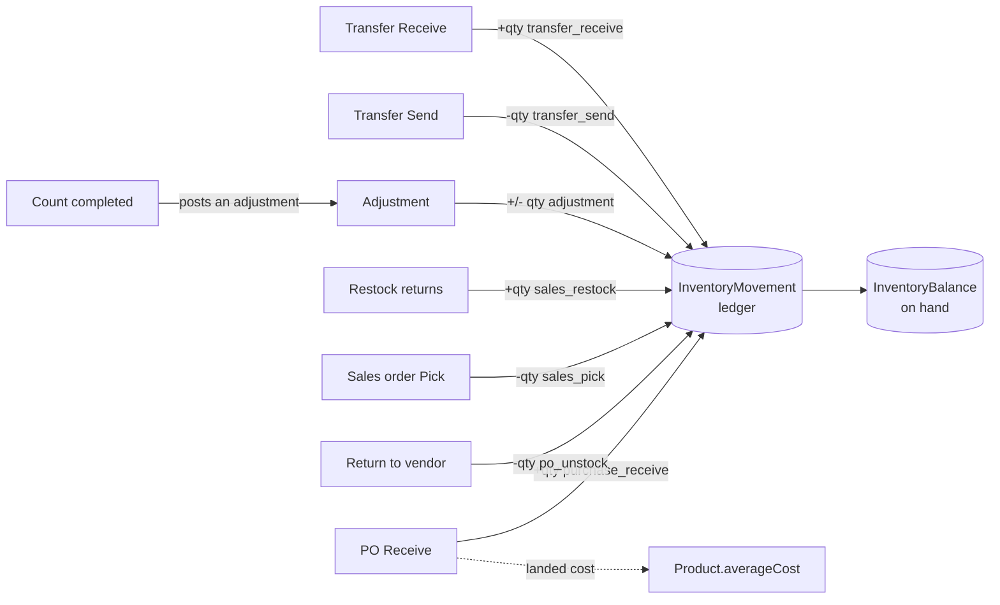

### Posting one line safely (compare and set, spec 0026)

Blocks has no transactions, but a filtered update is atomic on one record. A probe proved it: 10 identical updates fired at once, exactly 1 changed the record.

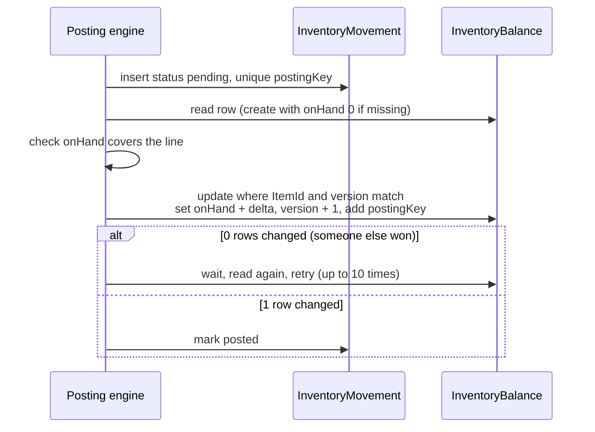

- The `postingKey` (`sourceType:sourceId:sourceLineId`) is unique, so a retry never counts twice.
- If the browser closes midway, the movement stays `pending`. After 2 minutes a repair step checks the balance's `appliedKeys`: key present → mark `posted`; absent → mark `failed`.
- A document posts line by line; if a line fails, the posted lines are reversed, so in effect it is all or nothing.
- Serial balances stay 0 or 1. On hand cannot go below zero unless an Admin or Manager confirms an override.
- The same compare and set guards `Product.averageCost` with `Product.costVersion` when receipts land.

### The quantities on the Stock screen

Computed in one pure function, `computeQuantities` in `src/features/stock/quantities.ts`. Only **on hand** is stored. Everything else is worked out from open documents, so it can't drift.

| Quantity | Formula | Comes from |
|---|---|---|
| **On hand** | sum of balances | `InventoryBalance.onHand` |
| **Picked** | `pickedQty − shippedQty` on open sales lines | `SalesOrder.lines` |
| **Reserved** (committed) | `stdQty − pickedQty` on open sales lines, plus open transfers going out | `SalesOrder.lines`, `StockTransfer` (status open, at the from location) |
| **On order** | `stdQty − receivedQty` on open PO lines, plus transfers coming in (open or in transit) | `PurchaseOrder.lines`, `StockTransfer` (at the to location) |
| **In transit** | quantity on transfers sent but not received | `StockTransfer` (status in_transit, at the to location) |
| **Available** | on hand − reserved | computed |
| **Anticipated** | on hand − reserved + on order | computed; drives `ReorderSuggestion` |

The same function's source is copied into the reorder check, so the Stock screen and the reorder list always agree.

**Worked example.** Location Dhaka, product Charger: balance on hand 50. Open sales orders want 20, 5 already picked → reserved 15. A PO for 40 not yet received → on order 40. Then available = 50 − 15 = 35, anticipated = 50 − 15 + 40 = 75. With a reorder point of 80, the charger shows on the Reordering list.
